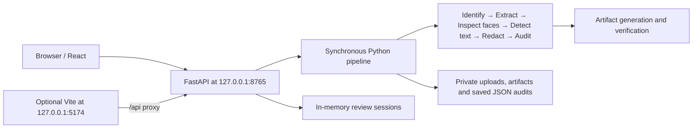

# Cadence PII Guard

## 1. Project overview

Cadence PII Guard is a local document privacy-review application developed in the Optiv project context. It extracts document content, detects policy-scoped personal information, supports explicit human corrections, and generates traceable redacted **review copies** of PDF, DOCX and PPTX files.

The product supports inspection before document-analysis workflows. No downstream AI connection is enabled. Technical artifact verification, completion of known review tasks, and complete PII coverage are separate states: **coverage remains NOT ESTABLISHED and downstream submission remains BLOCKED**.

The supported Windows runtime has passed real engine, HTTP, Chrome, and saved-audit restart/reload checks. Historical and current-session evidence, limitations and engineering decisions are recorded in [DEVELOPMENT_REPORT.md](DEVELOPMENT_REPORT.md).

## 2. Features

- Content-based document identification and PDF text/scanned/hybrid routing.
- Selectable PDF text extraction and local RapidOCR/ONNX OCR through Poppler.
- DOCX body, nested-table, header/footer extraction using logical paragraph locations; PPTX slide, group, table and accessible speaker-note extraction.
- Microsoft Presidio with English spaCy NLP and deterministic policy validation. The case-sensitive employee format is `EMP-` followed by exactly five ASCII digits.
- Separate anonymous face findings from a bundled, checksum-verified CPU YuNet model; mapped confirmed faces receive real pixel blur.
- Exact-span text tags, overlap handling, original-source artifact regeneration, and independently reopened/checked outputs.
- Bounded source evidence, confirm/reject decisions, manual missed-text findings, revision conflicts and audit events.
- Explicit JSON audit saving, saved-audit listing, and reload using the retained fingerprinted source.
- React dashboards, disposition charts, document-location maps, visual before/after crops, and private artifact downloads.

## 3. Architecture



[run.py](run.py) starts one Uvicorn process and serves the committed React bundle from [app/web/static](app/web/static). The Python engines run inside that process. No database, migration, queue, worker or separate model server is required.

Normal persistence is `.private_review_app/{uploads,artifacts,audits}`. Upload/feedback state is initially in memory; **Save audit** explicitly writes a snapshot. Reload validates/replays saved evidence and regenerates artifacts without rerunning original extraction or detection.

## 4. Technology stack

| Area | Implementation |
| --- | --- |
| Backend | Python 3.13, FastAPI 0.143.0, Uvicorn 0.54.0, Starlette 1.7.0, Pydantic 2.13.5 |
| Frontend | React/ReactDOM 19.2.0, TypeScript, Vite 7.3.7, Tailwind, Motion, Radix UI, Lucide, Visx |
| File/content processing | libmagic, pypdf, PyMuPDF 1.28.2, python-docx 1.2.0, python-pptx 1.0.2, lxml, Pillow |
| OCR | RapidOCR ONNX Runtime 1.2.3, ONNX Runtime 1.30.0, external Poppler binaries |
| Text detection | Presidio Analyzer 2.2.364, spaCy 3.8.16, pinned `en_core_web_lg==3.8.0`, custom deterministic recognizer/policy |
| Visual privacy | OpenCV Python 5.0.0.93, bundled YuNet ONNX model |
| Tests | pytest, httpx, ReportLab, Vitest, Testing Library, Node core tests and optional installed-Chrome harnesses |

Exact dependencies are in [requirements.txt](requirements.txt), [constraints-windows-py313.txt](constraints-windows-py313.txt) and [frontend/package-lock.json](frontend/package-lock.json). Selected upstream components and their adaptations are documented in [frontend/THIRD_PARTY_NOTICES.md](frontend/THIRD_PARTY_NOTICES.md); YuNet provenance is retained in [ATTRIBUTION.md](app/engines/visual_detection/assets/ATTRIBUTION.md).

## 5. Prerequisites

The verified configuration is **Windows 11 x64, Python 3.13.5**, pip 25.1.1 and Poppler 26.09.0. Windows 10 is a target environment but has not been independently tested. Other Python/platform combinations are not certified.

Install Git, Python 3.13 x64 with its launcher/pip, and Poppler Windows binaries. Windows PowerShell `powershell.exe` must be available because the Python storage helper internally uses it to restrict ACLs; your shell remains **Command Prompt**. VS Code is optional.

Poppler's executable directory must contain `pdfinfo.exe` and `pdftoppm.exe`. See [pdf2image's Windows installation instructions](https://pdf2image.readthedocs.io/en/latest/installation.html) for the download/extraction path. If necessary, replace this example with your actual extracted binary directory:

```cmd
set "PATH=C:\tools\poppler\Library\bin;%PATH%"
git --version
py -3.13 --version
where powershell
where pdfinfo
where pdftoppm
pdfinfo -v
pdftoppm -v
```

A browser is needed for the UI. **Node/npm are optional for normal execution**; frontend development was verified with Node 22.16.0/npm 11.12.0. Locked Vite requires `^20.19.0 || >=22.12.0`; use a compatible Node 22 version.

No Tesseract, PaddleOCR, CUDA/GPU, Microsoft Office installation, PostgreSQL, Redis, Supabase, Docker, external LLM, cloud resource or API key is needed. Package/model installation requires network access and sufficient disk space; the English model wheel alone is about 400.7 MB.

## 6. Installation

All shell blocks use Windows CMD syntax. In VS Code select **Terminal > Select Default Profile > Command Prompt**, then open a new terminal. Use a local writable checkout, avoiding network shares, public folders and junction/symlink traversal.

For a fresh clone, replace the repository URL:

```cmd
cd /d "%USERPROFILE%"
git clone "YOUR_REPOSITORY_URL" cadence-pii-guard
cd /d "%USERPROFILE%\cadence-pii-guard"
```

For an existing checkout elsewhere, use its actual root directory. Preserve an existing virtual environment and verify its Python version before reusing it.

```cmd
if not exist .venv py -3.13 -m venv .venv
call .venv\Scripts\activate.bat
python --version
python -m pip install -r requirements.txt
python -m pip install -r requirements-models.txt
python -m pip check
```

Expected: Python 3.13 and `No broken requirements found`. No `.env` file or application-specific environment variable is required. There is no database initialization or seed step.

[requirements-dev.txt](requirements-dev.txt) adds test tools. The runtime requirements include the exact Windows/Python constraints; constraints do not install unused test dependencies themselves. [requirements-models.txt](requirements-models.txt) pins the official English model URL and SHA-256. [The original dependency snapshot](docs/dependencies/requirements-original.txt) is historical evidence and must not be installed into the supported environment.

Optional installation checks:

```cmd
python -c "import fastapi,uvicorn,pypdf,pymupdf,docx,pptx,onnxruntime,cv2,spacy,presidio_analyzer; print('Runtime imports OK')"
python -c "import magic; print(magic.from_file('tests/fixtures/text.pdf', mime=True))"
python -c "from rapidocr_onnxruntime import RapidOCR; RapidOCR(); print('RapidOCR initialized')"
python -c "import spacy; print(spacy.load('en_core_web_lg').meta['version']); from app.engines.pii_detection import PIIDetectionEngine; PIIDetectionEngine(); print('Presidio initialized')"
python -c "from app.engines.visual_detection import FaceDetector; FaceDetector(); print('YuNet initialized')"
```

Expect MIME `application/pdf`, English model version `3.8.0`, and initializer messages. RapidOCR includes its inference assets; YuNet is already committed. No separate model process is started.

## 7. Running the application

Only one long-running terminal is needed after installation:

```cmd
cd /d "%USERPROFILE%\cadence-pii-guard"
call .venv\Scripts\activate.bat
python run.py
```

Successful startup is normally quiet at warning log level. In another CMD window:

```cmd
curl.exe --fail http://127.0.0.1:8765/api/config
start "" "http://127.0.0.1:8765/"
```

Expected configuration:

```json
{"max_upload_bytes":31457280,"supported_formats":["pdf","docx","pptx"],"trusted_local_only":true}
```

`/api/config` is the practical liveness check; `/health`, `/docs` and `/openapi.json` do not exist.

Upload a fictional supported document, inspect findings and source evidence, apply explicit reviewer decisions, download the private review copy, and **Save audit** if it must survive restart. Inspect stage states and `summary.failure`: an upload can return HTTP 200 with a processing-stage failure.

Save wanted revisions and allow active processing to finish before **Ctrl+C**. Restart with the same commands. Unsaved in-memory feedback is lost; saved audits need their original upload at the stored path. Moving the checkout or deleting uploads can prevent reload. Use `deactivate` to leave the venv. No other service needs to be stopped.

## 8. Frontend development

Keep Python running on 8765. In a second CMD terminal:

```cmd
cd /d "%USERPROFILE%\cadence-pii-guard\frontend"
npm ci
npm run dev
```

Open **http://127.0.0.1:5174/assets/**. Vite proxies relative `/api` requests to 8765. Use `127.0.0.1` exactly: the trusted Origin rewrite does not cover `localhost:5174`. Port 5174 is strict; there is no frontend `.env` configuration.

`npm run build` intentionally empties/replaces `app\web\static`; run it only for an intentional bundle update. The checked-in bundle is sufficient for normal startup.

## 9. Testing

Install regression tools in the existing project venv:

```cmd
cd /d "%USERPROFILE%\cadence-pii-guard"
call .venv\Scripts\activate.bat
python -m pip install -r requirements-dev.txt
set "PYTHONDONTWRITEBYTECODE=1"
python -B -m pytest tests -q -p no:cacheprovider
node --test tests\frontend\core.test.mjs
```

The bytecode setting reaches subprocesses and avoids changing tracked legacy `.pyc` files. Some tests inject analyzers; they are supplemented by real-engine and HTTP checks.

Frontend checks, from `frontend`:

```cmd
npm test
npm run lint
npx tsc --noEmit
```

Run large ML regression and Chromium workflows sequentially to avoid competing memory use.

For repeatable **real default-engine and live HTTP** checks, start the backend, then from a separate root CMD terminal choose a new synthetic-check directory:

```cmd
call .venv\Scripts\activate.bat
set "CADENCE_CHECK_DIR=.private_review_app\runtime-check-%RANDOM%-%RANDOM%"
python -B tools\verify_windows_runtime.py engines --work-dir "%CADENCE_CHECK_DIR%"
python -B tools\verify_windows_runtime.py api --work-dir "%CADENCE_CHECK_DIR%"
```

Save wanted reviews, restart Python in its own terminal, then run this in the same check terminal:

```cmd
python -B tools\verify_windows_runtime.py reload --work-dir "%CADENCE_CHECK_DIR%"
```

The tool creates fictional PDF/DOCX/PPTX/face fixtures and private evidence. Its fingerprint test temporarily alters only its own synthetic upload and restores its original bytes. See [testing and verification](DEVELOPMENT_REPORT.md#15-testing-and-verification) for browser harness settings, exact historical results and current consolidation regressions. Historical real-document diagnostics require private inputs/caches absent from a fresh clone and are not setup steps.

## 10. Supported formats and limitations

| Input | Supported path and boundary |
| --- | --- |
| Text PDF | Native extraction, mapped destructive text redaction and verification. Text/glyph alignment and supported geometry are required. |
| Scanned PDF | Poppler rendering and RapidOCR; confirmed text blocks are reconstructed in edited page rasters. OCR errors and block-level typography changes remain possible. |
| Hybrid PDF | Existing page-level native/OCR routes; mixed text/image routing has specific limitations described in the report. |
| DOCX | Supported paragraph/run/table/header/footer mappings; locations are logical segments, not physical pages. |
| PPTX | Slide/group/table/accessible-notes mappings; proven adjacent paragraphs in the same frame/cell can be edited across separators. |
| Embedded PNG/JPEG | Supported visual face inspection and mapped blur; image text is not comprehensively OCR-covered in Office files. |
| Standalone images/other files | The web workflow accepts only PDF/DOCX/PPTX; standalone image extraction is unsupported. |

The web upload cap is **30 MiB**. Metadata, unsupported Office constructs, annotations, charts, vectors, unsafe image mappings, unresolved findings and OCR discovery misses can leave sensitive content. Word/PowerPoint visual layout fidelity and comprehensive face/text recall are not certified.

`supported_content_verified` means supported mappings passed checks. `artifact_verified` has stricter conditions. Neither grants downstream clearance: `safe_for_llm`, `coverage_verified`, and `downstream_export_permitted` remain false. Zero candidates, completed operations, or an empty known review queue do not establish absence of PII.

## 11. Security considerations

The default launcher binds to loopback and disables access logs/proxy-header trust. Host/Origin validation, a required mutation header, upload bounds, opaque identifiers, revision guards, bounded source views and restrictive response headers protect the local workflow.

There is **no login, role enforcement, multi-user isolation, encrypted storage, signed audit ledger or production deployment configuration**. Reviewer identifiers are client assertions. Other local processes can call the trusted local API. Keep this application within its intended single-reviewer boundary.

Private directories receive current-user/SYSTEM ACLs; originals, review artifacts and audit snapshots remain **plaintext**. Keep private directories out of public/static hosting, retain original uploads for reload, and manage retention/backups deliberately. Full internal result serialization contains PII; `sanitized_summary()` is the limited aggregate view.

OCR uses Windows account temp storage by default. Optional private-temp setup, after dependencies work:

```cmd
python -c "from app.engines.audit.storage import AuditStore; AuditStore('.private_review_app/temp')._prepare()"
```

Only if that command succeeds, use these settings before starting Python in that same terminal:

```cmd
set "TEMP=%CD%\.private_review_app\temp"
set "TMP=%CD%\.private_review_app\temp"
python run.py
```

This reuses the existing ACL helper. It does not change the launcher's default temp behavior.

## 12. Troubleshooting

| Symptom | Action |
| --- | --- |
| Missing `magic` or other imports | Check `where python` and `python -m pip --version`; activate the project venv and install current requirements. Windows uses only `python-magic-bin`. |
| Old PaddleX/PyYAML conflict | Do not install the historical snapshot. Current runtime requirements exclude the unused experiment; never bypass the resolver with `--no-deps`. |
| spaCy `[E050]` / model unavailable | Run `python -m pip install -r requirements-models.txt`; verify `en_core_web_lg` loads. Allow the large official download to finish. |
| Missing Poppler / `PDFInfoNotInstalledError` | Verify both executables with `where`; set the actual binary directory on this CMD session's PATH. No `POPPLER_PATH` variable is read by this app. |
| Native DLL error | Verify x64 Python 3.13 and the constrained wheels; avoid overlapping OpenCV/libmagic providers in an old environment. Preserve existing environments when creating a separate clean one. |
| YuNet unavailable/untrusted | Restore the committed model from a trusted checkout; its expected hash is recorded in the report and attribution file. |
| OpenCV graph-target warning | CPU inference and blur passed despite this warning. Inspect actual stage results; installing a second OpenCV package is not the fix. |
| Storage/ACL failure | `where powershell` must resolve Windows PowerShell. Use a writable local private path, avoiding shares, junctions and denied public/root locations. Do not bypass ACL controls. |
| Port occupied | `netstat -ano -p tcp | findstr :8765` (or `:5174`); inspect `tasklist /fi "PID eq PID_NUMBER"`. Stop only a recognized process through its terminal. |
| HTTP 403 | Use trusted same-origin URLs. Curl mutations require `-H "X-Cadence-Local: 1"`; the browser adds it. |
| HTTP 409 | Refresh stale revisions or restore the original fingerprinted upload; saved artifacts cannot be regenerated from a changed/missing source. |
| HTTP 413 / 415 | Respect the 30 MiB cap and content-valid PDF/DOCX/PPTX formats. |
| Vite loads but upload is disabled | Check backend `/api/config`; frontend HTML alone does not prove processing is available. |
| HTTP 200 but processing failed | Inspect `summary.failure` and each stage. Vendor details are deliberately omitted from public errors. |
| Historical script fails | Old scratch/validation scripts may require private caches, historical source paths or experimental packages; they are not launchers. |

## 13. Development report

[DEVELOPMENT_REPORT.md](DEVELOPMENT_REPORT.md) is the authoritative engineering handoff: current module/API contracts, development history, detector evaluation, historical real-document findings, runtime stabilization, testing, security, maintenance priorities and the documentation-consolidation inventory.

The two retained Markdown exceptions are required attribution notices, not parallel setup/development guides. Their license texts and every non-Markdown source, test, manifest, JSON evidence file and model asset remain part of the repository.
